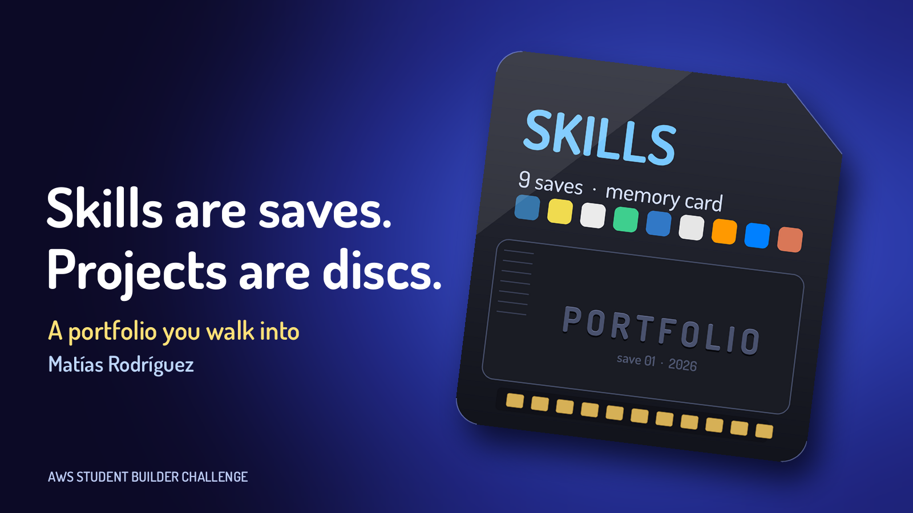
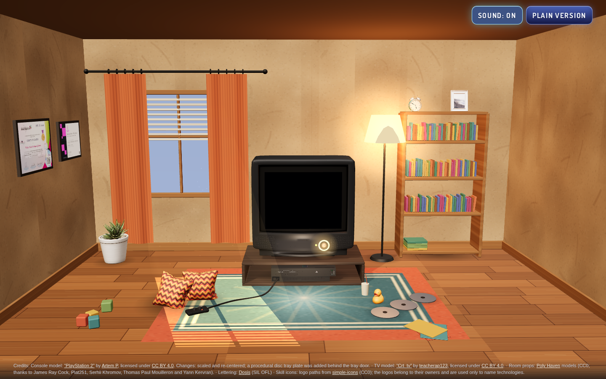
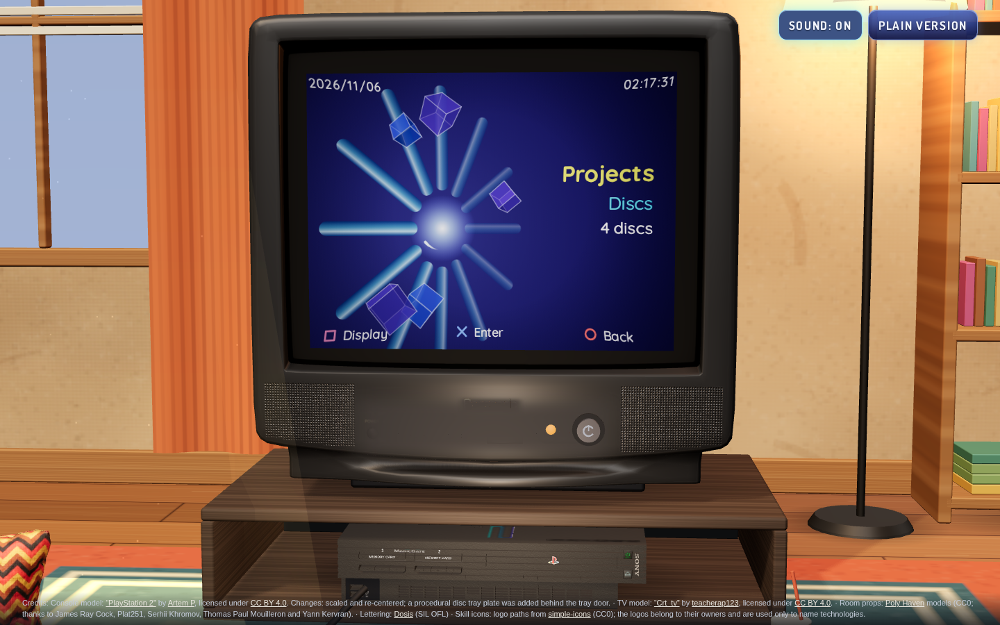
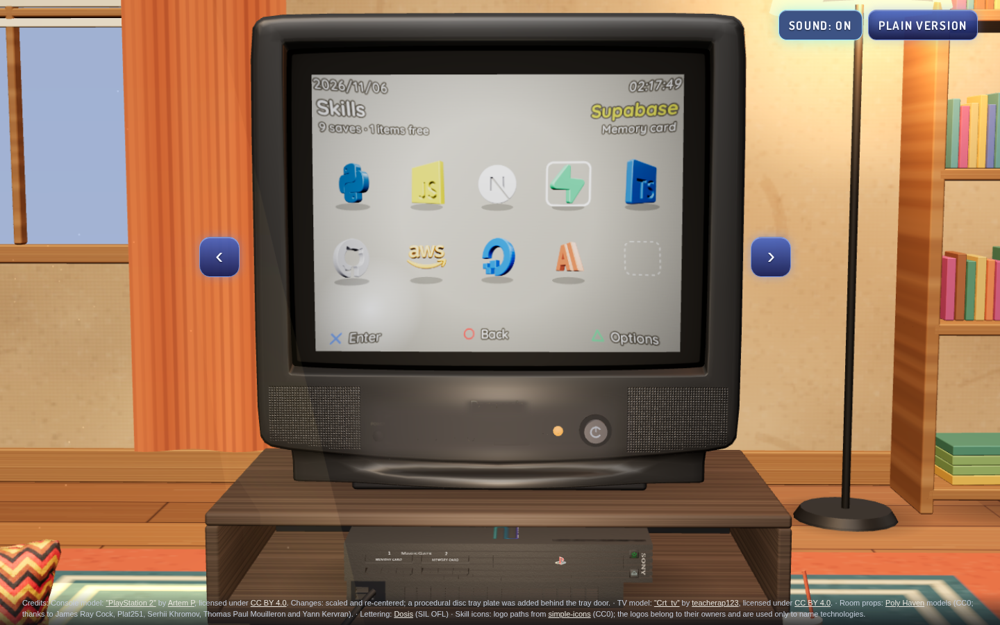
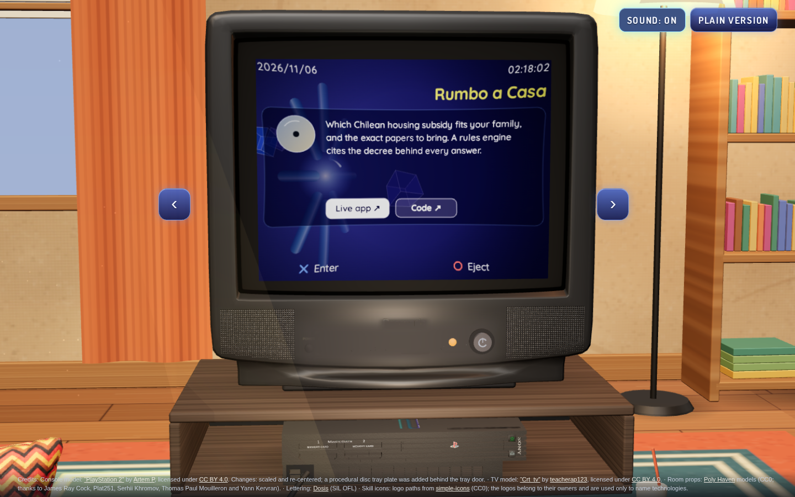
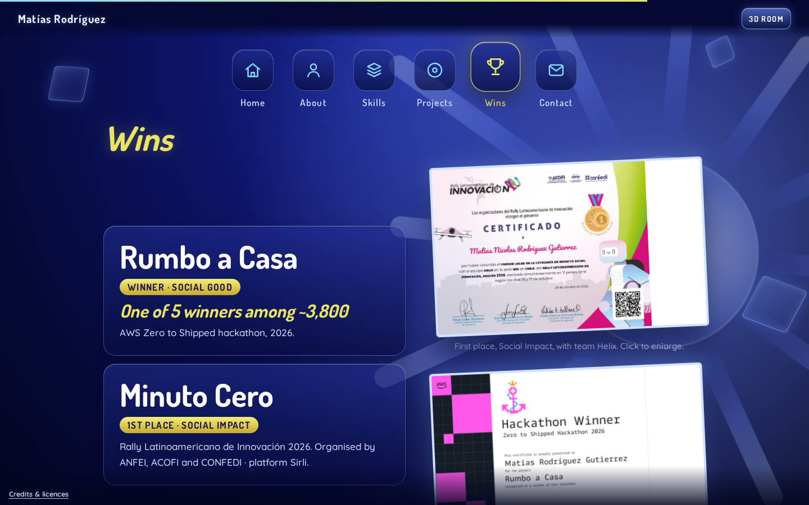
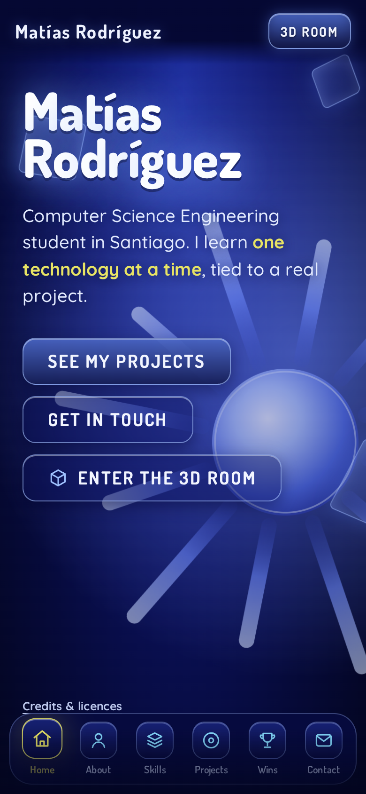
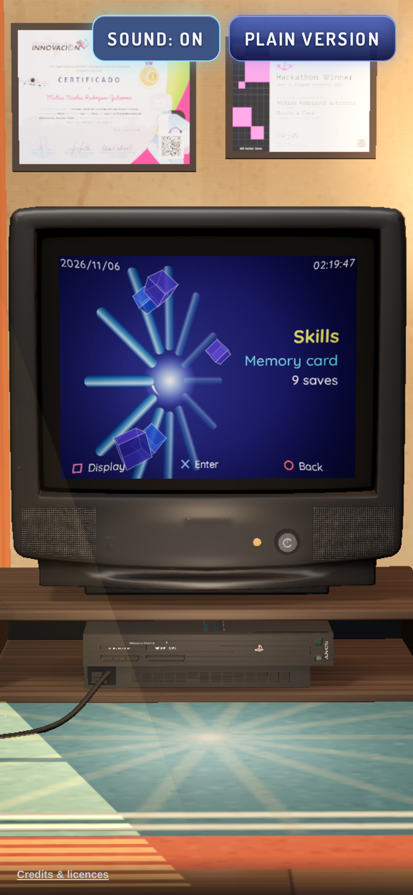

<h1 align="center">Matías Rodríguez · Portfolio</h1>

<p align="center">
  
</p>

<p align="center"><em>I would rather show you than list it: so the portfolio is a room with a PlayStation 2.</em></p>

<p align="center">
  <strong>A small bedroom with a CRT TV and a PS2. Switch the TV on, hear the console boot, and the menu on the screen is the portfolio.</strong><br />
  Built for the AWS Student Builder Challenge: Build Your Tech Superpower.
</p>

<p align="center">
  <a href="https://main.d5w3zjhtyz0vy.amplifyapp.com/"><strong>Live site</strong></a> ·
  <a href="https://main.d5w3zjhtyz0vy.amplifyapp.com/?view=2d">Plain version (no 3D)</a> ·
  <a href="docs/evidence/README.md">Evidence on AWS</a>
</p>

<p align="center">
  
  
  
  
</p>

<p align="center">
  
</p>

<table>
  <tr>
    <td width="33%"></td>
    <td width="33%"></td>
    <td width="33%"></td>
  </tr>
  <tr>
    <td align="center"><sub>The menu is the portfolio</sub></td>
    <td align="center"><sub>Skills are saves on a memory card</sub></td>
    <td align="center"><sub>Projects are discs</sub></td>
  </tr>
</table>

> 🏆 **Winner, Social Good · AWS Zero to Shipped hackathon 2026** with *Rumbo a Casa* · **1st place, Social Impact · Rally Latinoamericano de Innovación 2026** with *Minuto Cero*. Both hang on the wall of the room.

## The idea

A flat list of projects does not say much about the person who made them. A room does: the plant, the controller on the rug, the certificates on the wall. So the portfolio is a bedroom, and the way you move through it is the way you would use a console: switch the TV on, pick a disc, read a save.

## What it does

1. **A room that invites you in.** The TV starts off, a glowing ring marks its power button, and the camera glides to it when you click.
2. **A console boot.** A chord synthesized in the browser and a short intro play when the TV comes on.
3. **A menu that is the portfolio.** About, Skills (a memory card of saves with 3D icons), Projects (discs you insert into the console), Guestbook and Contact. Arrow keys and Enter, drag, scroll, or tap and swipe.
4. **A guestbook that is a memory card.** Visitors leave a save of their own (a name, a short message, a colour). Nothing goes public until I approve it.
5. **A plain version with the same content**, a PS2-style cross-bar of tabs for anyone who prefers a normal page. Phones start there.

<table>
  <tr>
    <td width="60%"></td>
    <td width="20%"></td>
    <td width="20%"></td>
  </tr>
</table>

## Decisions that matter

- **Sound is synthesized, not downloaded.** The boot chord, the menu sounds and every click are generated with Web Audio (`tools/sound-lab/`), and the intro is a 250 KB video rendered by `tools/intro/`. A full 3D room with no audio files.
- **The 3D room is optional, not required.** It is about 14 MB and heavy to warm up, so phones start in the plain version and the models are only fetched when you press "Enter the 3D room" (your choice is remembered). On phones the render resolution and the TV's redraw rate are tuned for legibility without melting the battery, and the page drops to a lighter profile if the frame rate stays low.
- **Licences are enforced by code.** `deploy/build-dist.py` refuses to build the package if any 3D model is not CC0 or CC BY. An early version of the room used models that could not be redistributed; this is how that mistake cannot come back.
- **Moderation before publication.** The guestbook has no login, so every new save waits as *pending* (and disappears after 14 days if I never review it). Only approved saves are public.

## Architecture

```
Browser ──► AWS Amplify Hosting (CDN) ── static site: index.html + assets
   │
   └─► API Gateway (HTTP API, throttled) ─► Lambda (Node.js 22) ─► DynamoDB
                                                  │                 ├─ saves (approved / pending, with TTL)
                                                  │                 └─ usage counters (atomic, with TTL)
                                                  └─► CloudWatch alarms ─► SNS
```

| Service | Role |
|---|---|
| **AWS Amplify Hosting** | Serves the site over HTTPS from a CDN. Deployed with `deploy/amplify-deploy.sh` (manual zip deployment), which verifies the public URL and writes a log to `docs/evidence/`. |
| **Amazon API Gateway (HTTP API)** | `GET /saves` and `POST /saves`, CORS limited to the site, a request-rate cap (5 requests per second, burst 10) before the function is even invoked. |
| **AWS Lambda** | Validates the request, applies the usage limits and reads or writes the table. TypeScript, no framework. |
| **Amazon DynamoDB** | One table: approved saves (60 days), pending saves (14 days) and the usage counters. Everything expires by TTL. |
| **Amazon CloudWatch + SNS** | An alarm for Lambda errors and one for unusual call volume, with an optional email alert (the address is set at deploy time and is not in the repository). |
| **AWS CloudTrail** | The audit trail of every deploy call. |
| **AWS CDK (TypeScript)** | The whole backend as code in `infra/`, with tests. |

### API

| Route | Purpose |
|---|---|
| `GET /saves` | The approved saves, newest first (up to 30). |
| `POST /saves` | Leave a save: `name` (up to 20 characters), `message` (up to 140), optional `color`. Answers `202` (pending review), or a clean `400`, `413`, `415`, `429` or `500` with a plain message. |

## Guardrails

There is no login, so the guestbook is protected by volume and by validation:

- **Usage limits** with atomic counters in DynamoDB: 3 saves per visitor per hour, 10 per minute and 300 per day for the whole site.
- **Validation of everything the visitor sends**: body size (2 KB), JSON shape, lengths, control and hidden characters, markup, links, a basic filter for insults, and a honeypot field that real visitors never fill.
- **Nothing is public until approved** (`deploy/moderate.sh list | approve | reject | remove`).
- **Alarms** for 5 or more Lambda errors in 5 minutes and for more than 600 calls in an hour.
- Backend and stack are covered by **46 tests** (`npm test`), with the DynamoDB client faked.

## Privacy

- No login, no cookies, no analytics, no ads. The only thing the browser stores is which version (3D or plain) you picked, in `localStorage`.
- A save holds a name, a message and a colour that the visitor typed. Do not write personal data in it.
- The visitor's IP is never stored: only a salted one-way hash, for about two hours at most, to enforce the limit.
- The contact section is plain links (email, GitHub, LinkedIn); there is no form.

## Accessibility

- The **plain version** has the whole content as a normal document, with keyboard navigation (arrow keys between tabs, skills and projects).
- `prefers-reduced-motion` is respected: the transitions, the spinning and the intro animation are replaced by static states.
- The 3D room works with the keyboard: arrow keys, Enter to open, Esc to go back.

## Repository layout

| Path | What it is |
|---|---|
| `site/` | The site: one `index.html` (three.js from a CDN) plus `assets/` (3D models, intro video, props, certificates) |
| `backend/` | The guestbook Lambda (TypeScript) and its tests |
| `infra/` | CDK stack for the guestbook API, table and alarms, with tests |
| `deploy/` | `build-dist.py` packs only what the page loads and checks licences; `amplify-deploy.sh` and `api-deploy.sh` deploy; `moderate.sh` approves guestbook entries |
| `tools/` | Generators used to make assets: the sound lab, the boot-intro renderer and the 3D skill-icon renderer |
| `docs/` | Notes, the AWS evidence (`docs/evidence/`: deploy logs and screenshots) and archived earlier directions |

## Run it

Requirements: Node.js 22+ for the backend, any static server for the site.

```bash
python3 -m http.server 8766 --directory site
# open http://localhost:8766/   (?view=3d forces the room on a phone, ?view=2d the plain version, ?quality=low the light profile, ?debug a performance panel)

npm install && npm test        # backend and CDK stack tests; no AWS calls
```

Serve the site over http: opened as a `file://` page the browser blocks the 3D models. The guestbook API only accepts requests from the deployed site, so on localhost the guestbook shows an error; that is expected.

## Deploy

```bash
aws login --profile <profile>        # when the session has expired
bash deploy/amplify-deploy.sh         # builds, checks licences, deploys, verifies, logs to docs/evidence/
bash deploy/api-deploy.sh             # the guestbook API (CDK)
```

## Built with a coding agent connected to AWS

The site was built with Claude Code, and the first deployment to Amplify was done by the agent through the official AWS MCP server; those calls are in CloudTrail (`docs/evidence/`). Some of the real problems along the way:

- **The 3D room lagged.** Instead of guessing, a diagnostics panel (`?debug`) measured it: the TV drawing cost 0.5 ms, the GPU was the cost. That led to dynamic resolution, and later to the phone profile.
- **The boot sound was wrong at first** (a low hum). Measuring the reference clips (spectrum and volume curve) showed a dense chord between 200 and 1300 Hz. Lesson: measure before you tune.
- **Licences:** several downloaded 3D models could not be redistributed. The packaging script now refuses to build if a model is not CC0 or CC BY.
- **A comment swallowed the code after it** (twice), silently breaking the page; each time it showed because the page stopped starting, and the fix was a test run in a real browser before deploying.
- **The room stayed stuck on the loading screen** on a real device while it worked in testing: the last warm-up step could throw without anyone noticing. It now skips the failing step and has a time limit.
- **An expired `aws login` session** looks like a broken deploy; it is not.

## Limits

- The 3D room is demanding. On a low-end phone the plain version is the better choice (and the default).
- The guestbook is moderated by hand and has no admin page.
- The site is one `index.html`; splitting it into modules would make it easier to maintain.
- The code of *Minuto Cero*, built with a team, is not in this portfolio; *Rumbo a Casa*, *FitTrack* and *Alexa-PC* are public and linked from the Projects section.

## Credits and licences

The code and the boot sounds, intro and icons renders in this repository are original work. Third-party material is limited to openly licensed assets, and the page footer credits it:

- **PlayStation 2** by Artem P, CC BY 4.0 (https://sketchfab.com/3d-models/playstation-2-99d0c0c7f024430ca1c6179a07d85ffa), scaled and re-centred.
- **Crt_tv** by teacherap123, CC BY 4.0 (https://sketchfab.com/3d-models/crt-tv-3b38466fa2f74b388c4a104e8872caca), with its printed brand and controls covered.
- **Room props** (aloe plant, throw pillows, rubber duck, alarm clock, picture frame) from [Poly Haven](https://polyhaven.com), CC0.
- **Skill icons** are extruded from [simple-icons](https://simpleicons.org) paths (CC0 data); the logos remain the property of their owners and are used only to name technologies.
- Typeface of the intro name: **Dosis** (SIL Open Font License). Boot sound, menu sounds and the intro are synthesized / rendered here; no Sony audio, logo or typeface is used.
- "PlayStation" is a trademark of Sony Interactive Entertainment; this project is an unofficial homage and is not affiliated with Sony.
